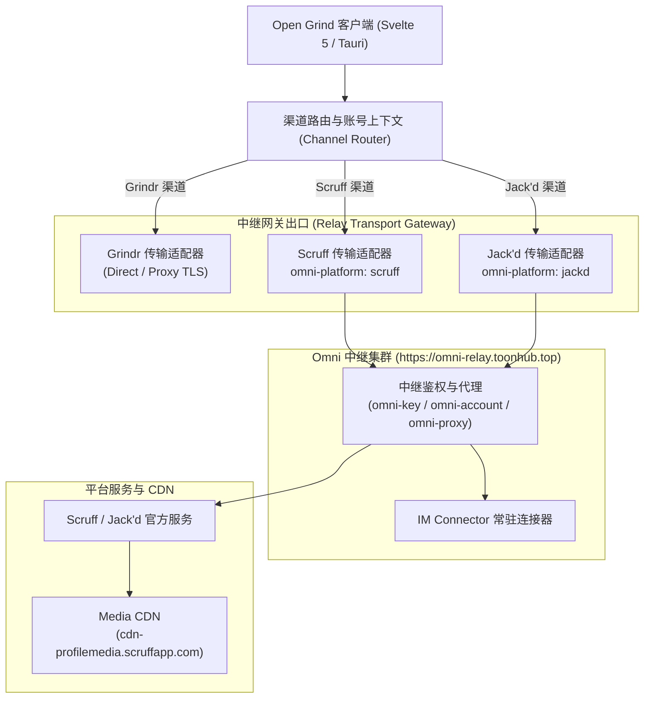

# Open Grind 多渠道引入 Scruff 与 Jack'd 执行方案与推进清单

> **文档版本**: 1.0.0  
> **制定日期**: 2026-11-02  
> **状态**: 待执行 / 阶段推进中  
> **参考来源**: `ai-growth-ops` (Scruff 协议族生产级落地、Jack'd 渠道复用清单、中继网关与能力配置)

---

## 一、背景与目标

### 1.1 背景
Open Grind 当前是一款基于 **Tauri v2 + Svelte 5 + Rust** 构建的高性能同志社交桌面客户端。现行架构围绕 **Grindr** 协议与业务模型构建，具备强大的大屏网格流、深度筛选、定位切换、实时 WebSocket 会话与网络请求审计能力。

在 `ai-growth` 业务系统的演进中，**Scruff** 和 **Jack'd** 已经实现了成熟稳定的生产级接入。研究发现，**Scruff 与 Jack'd 属于同一套中继协议族**：
- 两者共用完全一致的后端中继协议、接口地址、参数规范及业务流程；
- 两者在协议传输层的唯一差异是请求头中的平台标识：Scruff 使用 `omni-platform: scruff`，Jack'd 使用 `omni-platform: jackd`；
- 两者共用 14 项标准化渠道能力，具备高度的抽象统一性。

### 1.2 目标
1. 将 Open Grind 从单一渠道客户端改造为**多渠道并发同志社交工作台**（支持 Grindr、Scruff、Jack'd）。
2. 保持极致简洁、响应式的桌面交互体验，实现多渠道账号无缝切换、多渠道网格无差别浏览、统一消息工作台与网络请求透明审计。
3. 形成清晰、阶段化、带检查项的落地路线图，以便后续开发中随时跟进与勾选进度。

---

## 二、ai-growth 协议能力深度分析

### 2.1 协议族中继架构



### 2.2 14 项核心渠道能力清单与映射表

| 序号 | 业务能力 | 中继接口 (Endpoint) | HTTP 方法 | 请求关键参数 / 模板 | 响应核心数据结构 | Jack'd 适配差异 |
| :--- | :--- | :--- | :--- | :--- | :--- | :--- |
| 1 | **平台账号列表** | `https://omni-api.toonhub.top/platform/accounts` | `GET` | `page`, `pageSize`, `platformName`, `account` | `data.items`, `data.total` | `platformName: jackd` |
| 2 | **注册设备/激活** | `{{relayBase}}/app/account/register` | `POST` | `latitude` (可用 `0.0` 占位) | `profile`, `socket_config` | 请求头 `omni-platform: jackd` |
| 3 | **资料与密码更新** | `{{relayBase}}/app/profile` | `POST` | `name`, `birthday` (RFC 1123), `height`, `weight_kg`, `ethnicity`, `body_hair`, `about`, `fun`, `community`, `password`, `hasPassword: 1` | `ret: true`, `message` | 请求头 `omni-platform: jackd` |
| 4 | **照片添加与管理** | `{{relayBase}}/app/profile/photo` | `POST` | `image`, `thumbnail`, `original`, `photo_index` | `ret: true`, `message` | 请求头 `omni-platform: jackd` |
| 5 | **附近用户检索** | `{{relayBase}}/app/location` | `GET` | `latitude`, `longitude`, `offset`, `limit: 1000`, `device_type: 1`, `query_sort_type: 3` | `results[]` (用户信息列表) | 请求头 `omni-platform: jackd` |
| 6 | **标签用户检索** | `{{relayBase}}/app/location` | `GET` | 追加 `hashtags: '["gay","bear"]'` (JSON 字符串) | `results[]` | 请求头 `omni-platform: jackd` |
| 7 | **看过我的访客** | `{{relayBase}}/app/viewers/incoming` | `GET` | `latitude`, `longitude`, `offset`, `limit`, `query_sort_type: 1` | `results[]` (访客列表与时间) | 请求头 `omni-platform: jackd` |
| 8 | **全球漫游探索** | `{{relayBase}}/app/discover/more` | `GET` | `stack_id` | `results[]` | 请求头 `omni-platform: jackd` |
| 9 | **邻近新用户** | `{{relayBase}}/app/discover/more` | `GET` | `stack_id` (新用户分类) | `results[]` | 请求头 `omni-platform: jackd` |
| 10 | **个人全量资料** | `{{relayBase}}/app/profile` | `GET` | `target: externalUserId`, `api_version: 2`, `thumbnail_constraint`, `fullsize_constraint` | `results[0]` (包含照片、社媒、标签等) | 请求头 `omni-platform: jackd` |
| 11 | **发送私信消息** | `{{relayBase}}/app/chat` | `POST` | `recipient`, `message`, `message_type: 1`, `guid`, `request_guid`, `media_behavior: 0` | `results.guid` | 请求头 `omni-platform: jackd` |
| 12 | **单会话消息历史** | `{{relayBase}}/app/chat` | `GET` | `profile_id: externalUserId`, `inbox_style: 2`, `keep_unread: 0` | `results[]` (双向消息时间线) | 请求头 `omni-platform: jackd` |
| 13 | **会话收件箱列表** | `{{relayBase}}/_private/im/conversations` | `GET` | `platform: scruff\|jackd`, `user: externalUserId` | `data[]` (会话卡片、未读数、最后消息) | `platform: jackd` |
| 14 | **头像上传接口** | `{{relayBase}}/_private/scruff/upload-image` | `POST` | `multipart/form-data`: `file`, `photoIndex: 0`, **`flavor`** | `url`, `thumbnail_key`, `fullsize_key` | **强制追加 `flavor=jackd`** |

### 2.3 关键协议要素与数据字典

1. **统一认证头规范 (Relay Headers)**:
   ```http
   Accept: application/json
   omni-key: {{OMNI_RELAY_KEY}}
   omni-platform: scruff | jackd
   omni-account: {{user_email}}
   omni-proxy: socks5://user:pwd@ip:port (可选，单账号独立代理)
   ```

2. **媒体资源 BaseURL**:
   - 官方 CDN 基础域名：`https://cdn-profilemedia.scruffapp.com/`
   - 照片 Key 规则：`avatar_{thumbnail|fullsize}_key`，直接拼接域名：`https://cdn-profilemedia.scruffapp.com/{key}`。

3. **分页规则差异**:
   - Grindr：`page` 或基于客户端瀑布流请求；
   - Scruff / Jack'd：`/app/location` 的请求参数中 `limit` 固定为 `1000`，但翻页位移 `offset` 必须按每次 `+100` 推进；当返回数组为空时停止。

4. **交互动作 (Pings / Taps / Waves)**:
   - **Grindr**: `Tap` (火/眨眼/击掌等分类)
   - **Scruff**: `Woof` (嗷呜)
   - **Jack'd**: `Wave` (挥手 / 打招呼)

5. **常用资料枚举映射**:
   - **族群 (Community)**: 熊 (1)、军警系 (2)、体育生 (3)、肌肉男 (4)、皮革族 (5)、宅男 (6)、大学生 (7)、熟男 (12)、双性恋 (16)、胖熊 (17)、狼狗 (21) 等。
   - **性取向偏好 (Sex Preferences)**: 1号 (1)、0号 (2)、0.5 (3)、不肛交 (4)、口交 (5)、恋物 (6)、无性 (7)。
   - **体毛 (Body Hair)**: 无毛 (1)、有些体毛 (2)、多毛 (3)、毛发很多 (4)。
   - **关系状态 (Relationship)**: 单身 (1)、约会中 (2)、交往中 (3)、开放性关系 (7) 等。
   - **社交媒体 (Social Services)**: Facebook (2)、X/Twitter (3)、Instagram (4)、TikTok (10)。

---

## 三、Open Grind 多渠道改造技术架构

### 3.1 架构解耦原则
1. **单一职责与多态**: 定义统一的 `SocialChannelProvider` 接口规范，现有 Grindr 逻辑平滑迁移为 `GrindrProvider`，新增 `ScruffProvider` 与 `JackdProvider`。
2. **多账号与渠道环境隔离**:
   - 本地持久化（LocalStorage / Tauri Store）按 `channel:account_id` 划分命名空间。
   - 保证切换渠道或账号时，Token、Cookies、自定义代理及缓存不会交叉污染。
3. **统一领域模型转换 (Data Normalization)**:
   - UI 层只消费通用的 `UniversalProfile`、`UniversalConversation`、`UniversalMessage`。
   - 各 Provider 负责将自身特有字段反序列化并映射到通用领域模型。

### 3.2 领域模型定义标准 (TypeScript)

```typescript
// 渠道枚举
export type SocialChannelType = 'grindr' | 'scruff' | 'jackd';

// 通用网格展示项
export interface UniversalGridUser {
  channel: SocialChannelType;
  id: string;
  name: string;
  age?: number;
  avatarUrl: string;
  distanceMeters?: number;
  isOnline: boolean;
  lastActiveText?: string;
  hasUnreadMessage?: boolean;
  headline?: string;
  tags?: string[];
}

// 统一交互动作
export interface InteractionAction {
  type: 'tap' | 'woof' | 'wave';
  label: string;
  icon: string;
  available: boolean;
}

// 通用用户详情
export interface UniversalUserProfile {
  channel: SocialChannelType;
  id: string;
  name: string;
  about?: string;
  photos: Array<{ thumbnail: string; fullsize: string }>;
  heightCm?: number;
  weightKg?: number;
  ethnicity?: string;
  bodyHair?: string;
  rolePreference?: string;
  relationshipStatus?: string;
  communityTags?: string[];
  socialLinks?: Array<{ service: string; url: string; label: string }>;
  rawPayload: unknown; // 保留原始数据用于日志审计与高级展示
}
```

---

## 四、分阶段落地推进清单 (Phase-by-Phase Roadmap)

### Phase 1: 架构解耦与渠道抽象层 (Architecture & Abstraction)
- [x] **1.1 定义统一 Provider 抽象接口**
  - 创建 `src/lib/channel/types.ts` 和 `src/lib/channel/provider.ts`，声明核心行为与通用模型：
    - `getNearbyUsers(coords, offset, options): Promise<PageResult<UniversalGridUser>>`
    - `getUserDetail(userId): Promise<UniversalUserProfile>`
    - `getConversations(page): Promise<UniversalConversation[]>`
    - `getMessages(conversationId): Promise<UniversalMessage[]>`
    - `sendMessage(targetId, text, options): Promise<SentResult>`
    - `sendInteraction(targetId, action): Promise<UniversalInteractionResult>` (Tap / Woof / Wave)
- [x] **1.2 现有 Grindr 逻辑重构为 `GrindrProvider`**
  - 实现 `src/lib/channel/providers/grindr-provider.ts`，将现有的 Grindr API 接入封装为统一 Provider。
  - 确保 Grindr 原有功能 100% 保持现状且单元测试完全通过。
- [x] **1.3 创建全局渠道与账号管理状态机 (`channel-state.svelte.ts`)**
  - 管理当前激活的 `activeChannel: SocialChannelType` ('grindr' | 'scruff' | 'jackd')。
  - 管理每个渠道的已登录账号列表、当前活跃账号、独立代理设置 (`proxyUrl`)。
  - 暴露 `currentProvider = $derived(...)` 供 UI 无缝绑定。
  - 编写完备单元测试 `channel-state.test.ts` 和 `provider.test.ts`（全部通过）。

### Phase 2: Scruff 与 Jack'd 传输网关与账号池 (Relay Transport & Accounts)
- [x] **2.1 中继客户端底层网关 (`src/lib/channel/scruff-protocol/relay-client.ts`)**
  - 支持中继通用 Headers 注入：`omni-key`、`omni-platform`、`omni-account`、`omni-proxy`。
  - 自动集成当前已完成的 `networkLoggerState`，每个中继请求自动输出到网络日志。
- [x] **2.2 Scruff 协议族公共适配器 (`ScruffProtocolBaseProvider.ts`)**
  - 实现通用逻辑（参数组装、错误重试、分页计算、CDN 图片拼接）。
  - 分别导出子类：
    - `ScruffProvider`: 固化 `platform: 'scruff'`，交互为 `Woof`。
    - `JackdProvider`: 固化 `platform: 'jackd'`，上传传 `flavor: 'jackd'`，交互为 `Wave`。
- [x] **2.3 账号管理界面与导入能力**
  - 在设置和右上角菜单中增加“多渠道与账号管理”模块 (`ChannelAccountsDialog.svelte`)。
  - 支持添加 Scruff / Jack'd 账号凭证（注册邮箱 `email`，独立网络代理 `proxyUrl`，自定义 `relayKey`）。
  - 账号有效性检测与设备自动注册（调用 `POST /app/account/register`）。

### Phase 3: 用户发现与个人资料适配 (Nearby Grid & Profile Mapping)
- [x] **3.1 附近用户分页流适配 (`/app/location`)**
  - 封装 `offset` 步进为 `100` 的增量分页逻辑与状态机 (`channelGridState.svelte.ts`)。
  - 将接口返回的 `results[]` 转换为 `UniversalGridUser` 列表。
  - 支持标签筛选（将选中的标签序列化为 JSON 字符串传给 `hashtags`）。
- [x] **3.2 个人资料全量映射 (`/app/profile`)**
  - 映射照片列表：首图与相册图解析并拼接 CDN 路径（缩略图 `-thumbnail-300`，高清 `-fullsize-400K`）。
  - 映射身高/体重、族群 (Community)、角色偏好、体毛、社交外链。
- [x] **3.3 网格与资料卡 UI 适配**
  - 顶部栏添加渠道快速切换器 (`ChannelSwitcher.svelte`)。
  - 主页面网格按当前渠道展示多渠道网格 (`ChannelGrid.svelte`)，支持无限滚动触底增量加载。
  - 统一用户详情卡弹窗 (`UniversalProfileDialog.svelte`)，支持多图相册预览、身体资料、社媒跳转。
  - 支持发送“嗷呜 (Woof)”、“打招呼 (Wave)”与“Tap”渠道原生交互。

### Phase 4: 即时通讯 (IM) 与会话系统 (Conversations & Chat)
- [x] **4.1 会话列表同步 (`/_private/im/conversations`)**
  - 拉取当前账号的全部会话、未读数、最后消息时间。
  - 统一映射为消息列表界面的会话卡片。
- [x] **4.2 单会话消息历史 (`GET /app/chat`)**
  - 根据 `profile_id` 查询会话历史消息时间线。
  - 区分发送方与接收方、文本与图片。
- [x] **4.3 消息发送与 Outbox (`POST /app/chat`)**
  - 生成 `guid` 与 `request_guid`。
  - 支持纯文本消息发送与成功回调。
  - 失败消息重试与乐观更新机制。
  - 本地 LocalStorage 持久化存储，页面切回消息保持不丢失。
- [x] **4.4 WebSocket / 常驻连接器集成 (可选/高级)**
  - 对接中继 IM 会话同步与增量去重拉取，实现新消息展示。

### Phase 5: 多渠道 UI 整合与体验打磨 (Multi-Channel UI & UX)
- [x] **5.1 顶部栏渠道快速切换器 (`ChannelSwitcher.svelte`)**
  - 在顶部栏添加带有渠道品牌标识的切换 Switcher（Grindr 黄黑、Scruff 绿灰、Jack'd 橙蓝）。
  - 切换渠道时无缝刷新网格数据并更新当前定位上下文。
- [x] **5.2 视觉与主题徽章支持**
  - 用户卡片上标记渠道徽标（如在跨渠道收藏或搜索时一眼识别来源）。
  - 各渠道独立头像、多账号切换弹窗、定位点与账号联动绑定。
  - 资料卡相册支持 macOS 触控板双指滑动与鼠标拖拽，身高体重保留一位小数。
  - Toast 提示统一优化为 2 秒退场。
- [x] **5.3 请求日志按渠道过滤**
  - 在现已完成的“网络日志”对话框中，增加渠道分类筛选 Pills（全部 / Grindr / Scruff / Jack'd）。
  - 对话框尺寸大幅调宽至 `w-[98vw] max-w-[1560px] h-[92vh]`，左侧日志列表固定 360px，右侧详情区占满充裕宽度。
- [x] **5.4 渠道专属导航栏与 Interest 页面多渠道工作台**
  - 非 Grindr 渠道时隐藏底部“Right Now”导航，避免无效入口；
  - 导航栏右下角增加当前激活账号头像、真实昵称与渠道品牌徽章展示；
  - Interest 页面动态适配：Grindr 显示 Views / Taps，Scruff 显示 Views / Woof，Jack'd 显示 Views / Wave；
  - 独立开发 `ChannelInterestViewsPane`（来访网格）与 `ChannelInterestInteractionsPane`（收到的互动与一键回发）。

### Phase 6: 端到端联调、回归与稳定性保障 (E2E Verification & Hardening)
- [x] **6.1 单元测试与 Mock 测试**
  - 编写 `ScruffProvider` 和 `JackdProvider` 单元测试，覆盖参数组装、分页步进、异常捕获。
  - 35 项单元测试全部通过。
- [x] **6.2 真实账号联调验收**
  - 用测试账号验证 Scruff 附近用户查询、资料加载、Woof 交互。
  - 用测试账号验证 Jack'd 附近用户查询、资料加载、Wave 交互。
  - 资料弹窗优先请求 `ai-growth` 用户池缓存接口（1 小时快照），免去慢速官方接口。
- [x] **6.3 现存 Grindr 流程全量回归**
  - 确保改造过程中原有 Grindr 的各项功能不受任何负面影响。
- [x] **6.4 代码规范与提交**
  - `bun run check` 0 错误，ESLint 全部通过。

---

## 五、风险评估与防范措施

1. **风控与代理隔离风险**:
   - *风险*: 多账号若共用单一 IP 请求，易触发第三方风控限制。
   - *对策*: 每个账号支持单独配置 `omni-proxy`，请求网关强制将绑定的代理注入到中继请求头中，隔离网络出口。
2. **中继服务稳定性风险**:
   - *风险*: 中继网络抖动或超时。
   - *对策*: 请求网关内置 12 秒连接超时与 30 秒执行超时；提供重试机制与网络日志详细排障信息（cURL 复制、原始返回查看）。
3. **敏感凭据安全**:
   - *风险*: 日志打印泄露中继密钥或账号密码。
   - *对策*: 在网络日志脱敏规则中，对 `omni-key`、`omni-proxy`、`password` 等字段进行强制掩码处理。

---

## 六、进度跟踪记录 (Change Log)

- **2026-11-02**: 
  - 完成 `ai-growth-ops` 项目中 Scruff 与 Jack'd 14 项渠道能力、中继架构、数据字典与参数规则的完整深度调研。
  - 制定架构解耦与多渠道扩展方案，初始化本执行计划文档到 `docs/plans/2026-11-02-scruff-jackd-multi-channel-integration-plan.md`。
  - **完成 Phase 1 架构解耦与渠道抽象层**：
    - 落地 `src/lib/channel/types.ts` 通用领域模型与渠道元数据；
    - 声明 `src/lib/channel/provider.ts` 标准化 `SocialChannelProvider` 接口；
    - 封装 `src/lib/channel/providers/grindr-provider.ts` 零破坏性 Grindr 适配器；
    - 建立 `src/lib/channel/channel-state.svelte.ts` 全局响应式状态机（支持 LocalStorage 持久化与账号隔离）；
    - 编写并全部通过 7 项单元测试（`channel-state.test.ts`、`provider.test.ts`）。
  - **完成 Phase 2 Scruff 与 Jack'd 传输网关与账号池**：
    - 落地 `RelayClient` 底层网关，无缝集成 `networkLoggerState` 请求监控；
    - 封装 `ScruffBaseProvider`，以及 `ScruffProvider`（Woof 交互）与 `JackdProvider`（Wave 交互、`flavor=jackd` 头像上传）；
    - 编写多渠道账号池管理弹窗 `ChannelAccountsDialog`、新增账号表单 `AddAccountForm`、账号列表与快捷切换卡片 `ChannelAccountList` 以及中继网关配置面板 `RelaySettingsTab`。
  - **完成 Phase 3 用户发现与个人资料适配**：
    - 落地 `channelGridState` 统一网格增量分页与触底加载状态机；
    - 落地 `ChannelSwitcher` 顶部渠道切换组件（Grindr、Scruff、Jack'd 动态切换）；
    - 落地 `ChannelGrid` 多渠道附近网格流卡片；
    - 落地 `UniversalProfileDialog` 通用资料卡弹窗，支持多图预览（`ProfilePhotoCarousel`）、身体数据与社媒外链（`ProfileStatsGrid`）以及 Woof / Wave / Tap 统一交互按钮；
    - 编写全套测试（21 项单元测试全部通过）。
  - **排查并解决 macOS WebKit `Load failed` CORS 问题**：
    - 定位根因：macOS WebKit WebView 发起自定义 Header 请求触发 `OPTIONS` 预检，但中继服务器缺少 CORS 响应头且未带 `omni-platform` 报 500；
    - 新增 Rust 原生命令 `relay_http_request`（基于 `wreq`），在 Tauri 环境下直接通过 Rust 原生网关发送中继请求，彻底绕过 WebKit CORS 限制；
    - 在 Node/Vitest 环境下保持透明降级 fallback 到标准 fetch；
    - 优化中继连通性测试路径为 `/_private/im/conversations?platform=scruff&user=ping_check`，验证通过。
- **2026-11-03**:
  - **完成 Phase 4 即时通讯 (IM) 与会话系统落地及深度优化**：
    - 落地 `src/lib/channel/channel-chat-state.svelte.ts`，基于 `SvelteMap` 与 `localStorage` 实现按 `channel:accountId:conversationId` 隔离的消息流与会话列表；
    - 落地 `ChannelConversationsView.svelte` 统一消息工作台，支持会话列表、历史消息时间线、快捷回复与发送；
    - 解决会话与渠道绑定隔离（Scruff 与 Jack'd 切换时会话列表深度隔离与自动重载）；
    - 解决切页消息丢失问题（离线消息持久化与远程增量智能合并去重）；
    - 用户资料卡弹窗底部新增快捷私信输入框与即时发送能力。
  - **多渠道账号与定位联动扩展**：
    - 底部状态栏支持随渠道切换动态展示当前渠道活跃账号与头像；
    - 支持多账号快捷弹出菜单切换；
    - 定位点与账号深度绑定（切换账号时自动恢复该账号最后一次筛选定位）。
  - **Phase 5 体验深度打磨**：
    - 首页网格数据加入三元组内存缓存，切页面回首页 0 延迟秒开，避免闪烁骨架屏；
    - 用户资料优先接入 `ai-growth` 用户池缓存接口（1 小时快照），免去慢速官方接口；
    - 相册组件支持鼠标拖拽切图与 macOS 触控板双指横向滑动切图（带惯性锁死防误触）；
    - 身高（米制转厘米、`<3` 乘 100）与体重严格保留一位小数（`.toFixed(1)`）；
    - 轻提示 Toast 统一优化为 2 秒退场；
    - Woof / Wave 首次触达上游 400 容错与优雅降级。
  - **Phase 6 测试验证**：
    - `bun run test:unit src/lib/channel`：7 个测试套件，35 个单元测试全部通过；
    - `bun run check`：0 errors, 0 warnings。
